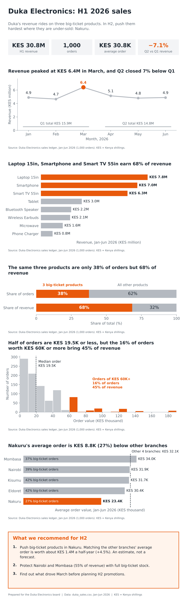

# Duka Electronics: H1 2026 One-Page Board Report



## Board Summary

Duka Electronics earned KES 30.8M from 1,000 orders in the first half of 2026. Three big-ticket products (Laptop 15in, Smartphone and Smart TV 55in) are only 38% of orders but 68% of revenue, so the business depends on them.

Growth has stalled. Revenue peaked at KES 6.4M in March, and the second quarter closed 7% below the first. Half of all orders are worth KES 19.5K or less, so a small number of large sales decides the result.

Nakuru is the clearest gap. Its average order is KES 23.4K, against KES 32.1K across the other four branches, because only 27% of its orders are big-ticket.

We recommend three priorities for the second half. First, push big-ticket sales in Nakuru, worth about KES 1.4M if its average order reaches the peer level. Second, keep Nairobi and Mombasa, 55% of revenue, fully stocked. Third, find out what drove March before planning promotions.

---

## Repository contents

| Path | What it is |
|---|---|
| `README.md` | This page: the one-page report and the Board Summary |
| `board_report.ipynb` | Storyboard (audience, decision, Big Idea, SCR) first, then data checks, five charts with insight titles calculated in code, the one-page layout, the before/after makeover and the H2 sizing. Run top to bottom with all outputs visible |
| `reports/duka_board_report.png` | The final single-page report (1,600 px wide, 200 dpi, portrait for phones) |
| `figures/before.png`, `figures/after.png` | The "Revenue by product" chart before and after the makeover |
| `dashboard.md` | Looker Studio dashboard link, screenshots and build notes |
| `data/duka_sales.csv` | Source data from Week 3 (1,000 orders, Jan to Jun 2026) |
| `data/duka_sales_clean.csv` | Cleaned export with `revenue`, `price_band` and `date_key`, used as the Looker Studio data source |
| `requirements.txt` | Python libraries used |

## How to reproduce

```bash
pip install -r requirements.txt
jupyter notebook board_report.ipynb      # Kernel > Restart & Run All
```

## Key assumptions

- `revenue = units x unit_price`, in Kenya shillings (KES).
- **Big-ticket** = the three products with the highest H1 revenue, identified in code (Laptop 15in, Smartphone, Smart TV 55in).
- Average order value = revenue / number of orders. The "other branches" average is order-weighted.
- The KES 1.4M Nakuru opportunity is a what-if (same number of orders, average order raised to the peer level), not a forecast. Revenue is not profit, so margin data should be checked before committing budget.
